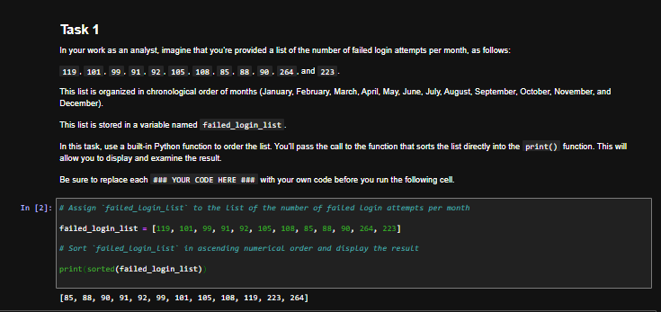
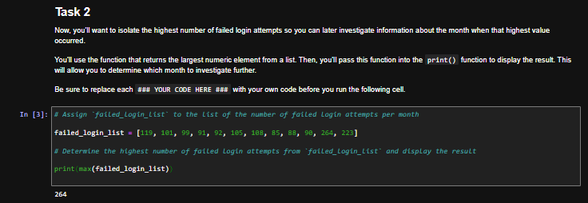
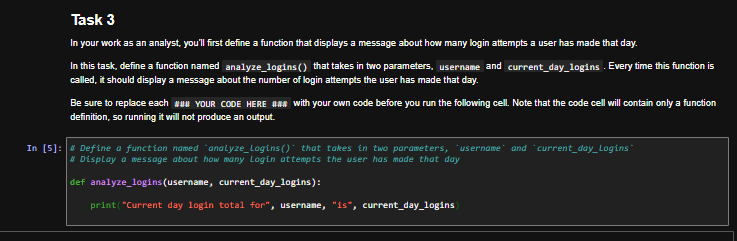
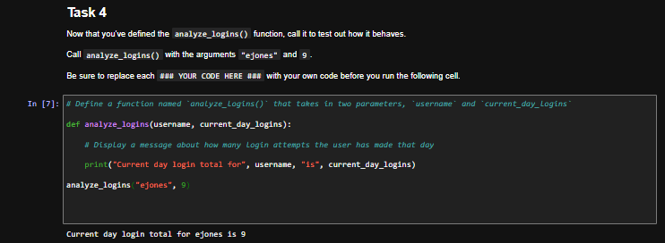
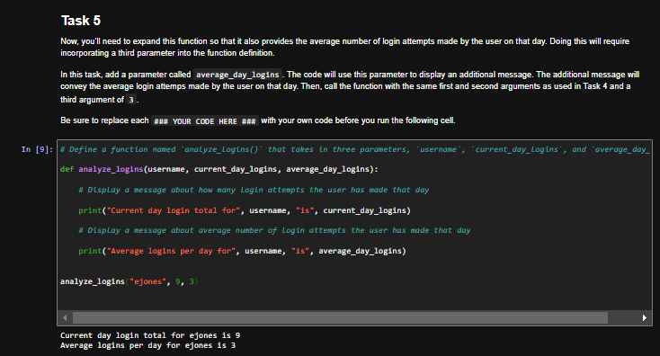
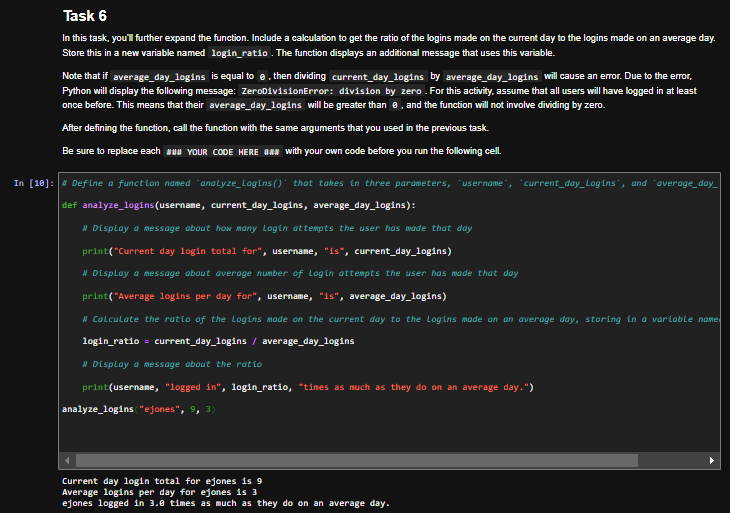
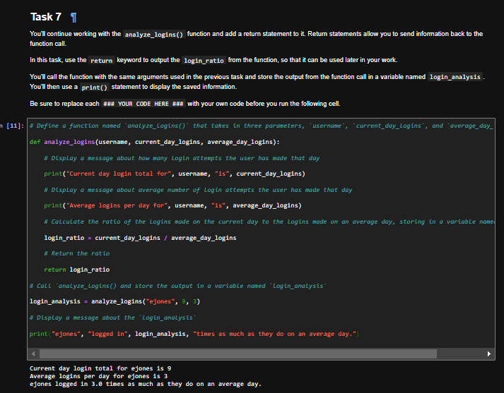
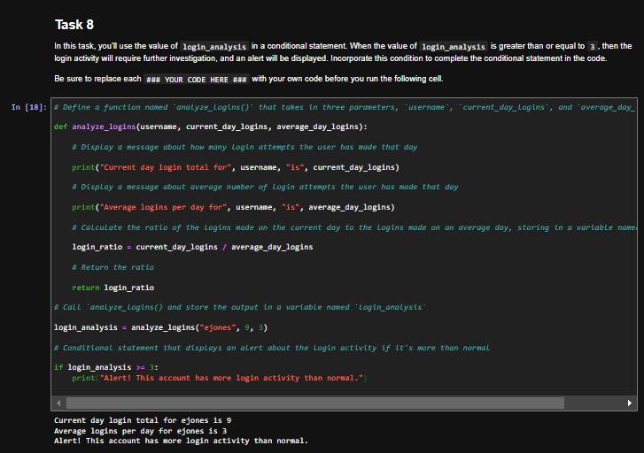

# Python Functions: Built-in Functions, Parameters, and Return Values for Login Analysis

## Summary

In this lab from the Google Cybersecurity Certificate (Automate Cybersecurity Tasks with Python), I used Python's built-in functions to analyze monthly failed login attempts, then built my own `analyze_logins()` function step by step: adding parameters, calculating a login ratio, returning that value, and using it in a conditional that flags unusual login activity. The scenario, usernames, and numbers are fictional and provided by the course.

## Tools Used

- Python 3
- Jupyter Notebook (course lab environment)

## Skills Demonstrated

- Built-in functions: `sorted()`, `max()`, and `print()`
- Defining functions with one or more parameters
- Calling functions with arguments
- Calculations inside a function
- Returning a value with `return` and storing it in a variable
- Using a returned value in an `if` statement to raise an alert

## Part 1: Built-in Functions on Failed Login Data

The list holds the number of failed login attempts for each month, January through December.

**Task 1: sort the list.** `sorted()` returns the values in ascending order without changing the original list.

```python
failed_login_list = [119, 101, 99, 91, 92, 105, 108, 85, 88, 90, 264, 223]

print(sorted(failed_login_list))
```



**Task 2: find the highest value.** `max()` returns the largest number, 264, which is November, the month to investigate further.

```python
print(max(failed_login_list))
```



## Part 2: Building the analyze_logins() Function

**Task 3: define a function with two parameters.** The function displays how many times a user logged in today. Running the cell only defines the function, so there is no output.

```python
def analyze_logins(username, current_day_logins):
    print("Current day login total for", username, "is", current_day_logins)
```



**Task 4: call the function.** The arguments `"ejones"` and `9` fill the `username` and `current_day_logins` parameters.

```python
analyze_logins("ejones", 9)
```



**Task 5: add a third parameter.** `average_day_logins` adds a second message with the user's average logins per day.

```python
def analyze_logins(username, current_day_logins, average_day_logins):
    print("Current day login total for", username, "is", current_day_logins)
    print("Average logins per day for", username, "is", average_day_logins)

analyze_logins("ejones", 9, 3)
```



**Task 6: calculate a login ratio.** Dividing today's logins by the daily average shows ejones logged in 3.0 times as much as usual. Division with `/` returns a float, so the result shows as 3.0.

```python
def analyze_logins(username, current_day_logins, average_day_logins):
    print("Current day login total for", username, "is", current_day_logins)
    print("Average logins per day for", username, "is", average_day_logins)
    login_ratio = current_day_logins / average_day_logins
    print(username, "logged in", login_ratio, "times as much as they do on an average day.")

analyze_logins("ejones", 9, 3)
```



## Part 3: Returning a Value and Flagging Unusual Activity

**Task 7: return the ratio.** `return login_ratio` sends the value back to the caller, where it is stored in `login_analysis` and used outside the function.

```python
def analyze_logins(username, current_day_logins, average_day_logins):
    print("Current day login total for", username, "is", current_day_logins)
    print("Average logins per day for", username, "is", average_day_logins)
    login_ratio = current_day_logins / average_day_logins
    return login_ratio

login_analysis = analyze_logins("ejones", 9, 3)
print("ejones", "logged in", login_analysis, "times as much as they do on an average day.")
```



**Task 8: alert on high activity.** When the returned ratio is 3 or more, the script displays an alert that the account needs further investigation.

```python
login_analysis = analyze_logins("ejones", 9, 3)

if login_analysis >= 3:
    print("Alert! This account has more login activity than normal.")
```



## Key Takeaways

- Built-in functions like `sorted()` and `max()` quickly surface patterns in security data, such as the month with the most failed logins.
- Parameters are placeholders in a function definition, and arguments are the actual values passed in when the function is called; their order matters.
- `print()` only displays a value, while `return` hands it back so it can be stored in a variable and reused.
- A returned value can drive a conditional, turning a calculation into an automated alert for unusual account activity.
- Dividing by a daily average assumes the average is greater than 0; a value of 0 would cause a `ZeroDivisionError`.
